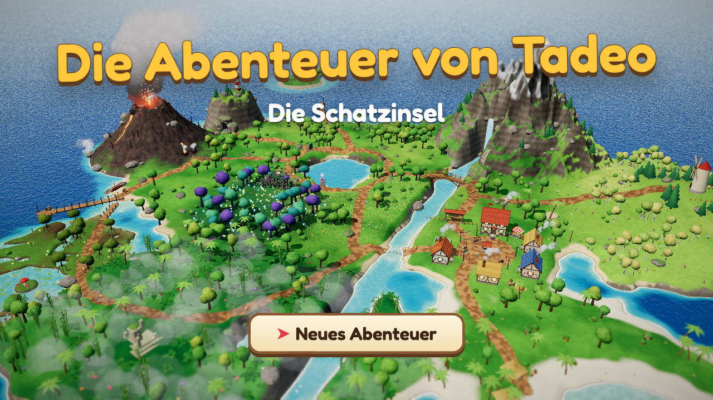

# Die Abenteuer von Tadeo: Die Schatzinsel

A 3D treasure-hunt adventure built with **Three.js**, **TypeScript** and **Vite**, made for Tadeo
(7 years old). You play as **Tadeo** with his hen **Chuleta**: explore a lush toon-style island,
follow a story of twelve quests: the volcano's heart was stolen, and Tadeo finds four old things and
brings it home. Along the way he helps the villagers and sails to a treasure island. All text and
narration are in German.



## Highlights

- Hand-built 3D island: shader water with shore foam, wind-blown grass, instanced vegetation,
  volcano smoke, chimney smoke, birds, butterflies, crabs, fireflies, waterfall and river
- Four regions around the old island, linked by paths: a lagoon with a jetty, beach huts,
  turtles and dolphins; a misty jungle with an old ruin and parrots; a swamp with a boardwalk, frogs and
  fireflies; flower hills with a windmill and sheep
- Post-processing: bloom, tilt-shift, ACES tone mapping, vignette
- Rendering capped at 60 FPS and 1.25× pixel density, with 2× multisample anti-aliasing to limit GPU load
- Chibi toon characters with outlines; Chuleta the hen runs along, rides on Tadeo's head and gives hints
- Twelve quests that tell one story. Most play in their own 3D challenge scene (loaded on demand), and the
  island follows the story: the volcano rumbles harder after every quest, thorns block the magic arch that is
  the only way into the Zauberwald and a boulder closes the mountain trail until Tadeo can open them, and his
  mended boat appears at the north dock
- Side games in the village, gold coins all over the island, and outfits to unlock
- Natural-sounding German voices for every line (recorded with ElevenLabs), with browser speech as fallback
- A recorded acoustic soundtrack that changes with the place and the quest, and island sounds that follow Tadeo
- No game over anywhere: mistakes just restart the current attempt

## The adventure

The volcano has a heart, the *Feuerherz*. A young pirate stole it long ago, and since then the volcano
is waking up and the monsters are angry. Tadeo finds the pirate's map in a bottle, learns from the lake's
guardian which four things he needs (sword, berries, hammer, key), and brings the heart back. The pirate
turns out to be Käpt'n Paco, who has been helping him all along.

| # | Quest | What happens |
|---|-------|--------------|
| 1 | Ankunft | Tadeo finds a bottle on the beach with a map of a small island and a big X. A shark smashes his boat at sea and he washes ashore. A voice calls for help from the volcano |
| 2 | Der Vulkan | Cross the lava fields and dodge the glowing circles where lava bombs land. The eruptions broke two bridges, so jump across the rocks with Space. Free Käpt'n Paco from under a rock beside an old stone with an empty heart-shaped hollow |
| 3 | Das Dorf | Walk to the village over the stepping stones, because the ogre holds the bridge. The elder tells about the Feuerherz and sees the map: the X must be where the heart is |
| 4 | Der See | Three stone tablets at the lake ask a riddle each; pick the answer with the arrows. The Hüter, a ghost with no hands, rises from the water and tells the rhyme of the four things |
| 5 | Die Höhle | Torch-lit natural cave: feed a hungry mole glowing mushrooms so he digs through two rockfalls, then touch three crystals in the order the cave paintings show to reach the magic sword |
| 6 | Der Zauberwald | A thorn hedge closes the gate until the sword's blue light drives it back; then, in the twilight forest, Flocke the fox leads you to five glowing berry sprigs |
| 7 | Das Dorf | The elder tells where the old key came from (it lay on his doorstep, for someone clever); campfire drum trials and a maths question; reward: the golden key. He then sends you to the ogre for the boulder |
| 8 | Der Oger | Card battle on the bridge (attack with the sword, heal with berries, special); block his swings with Space at the right moment. At the end he takes a berry and becomes a friend, and back on the island he heaves the boulder off the mountain trail |
| 9 | Der Berg | Side-view climb on the old people's path with rolling rocks, snowballs and a rope bridge; reward: the golden hammer, for the magic ice |
| 10 | Der Hai | Tadeo's mended boat waits at the north dock. Sail along a trail of glowing starfish, then calm the giant shark by throwing three berries into its open mouth |
| 11 | Die Schatzinsel | Dig at the X, break the magic ice with the hammer, unlock the chest with the key: gold, a crown, Paco's note, a plan and the Feuerherz. Then the volcano erupts |
| 12 | Das Herz des Vulkans | Sail back and climb the erupting volcano with the heart (the hardest rock rate), set it on the old stone, and the volcano sleeps. The island celebrates a night festival; Paco owns up. End card |

**Side games** (any time, in the village): fishing with *Fischer Jonas* and catching *Kleine Mia's*
runaway hens. The first win earns a prize hat (fishing hat, golden crown).

**The turtle family** (any time, at the lagoon): *Frau Moos'* five babies have run off along the beach. Walk close
to one and it runs after Tadeo; bring them all to her at the water for the turtle hat.

**Coins and outfits:** 50 gold coins are hidden on the island, along the paths and in secret corners, about eight in
each outer region. 15 coins unlock a straw hat, 25 a pirate hat, 35 a feather hat and all 50 cool sunglasses; the coin
bar shows the next outfit and how many coins it takes. Tadeo wears the hat he got most recently, and an outfit once
earned stays.

## Controls

- **Arrow keys** (or WASD): walk, choose
- **Space** (or Enter): talk, read, jump, confirm, advance dialogue
- **M**: sound on/off
- **V**: voice narration on/off
- **Esc**, or a click on the small ship's wheel in the bottom-right corner: the menu

The menu pauses the game. It switches sound, music and voice on and off, and its list "Spielen ab" starts the
story at any quest and plays on from there to the end. While Tadeo walks the island freely it also shows a map of
12 places he can travel to. Arrows and Space work it as well as the mouse.

The music starts as soon as the page loads if the browser allows sound. A browser that holds sound back
until the first key or click (Chrome on a first visit, for example) starts it on that press.

## Getting started

### Prerequisites

- Node.js 20.6+ and npm

### Install and run

```bash
npm install
npm run dev        # http://localhost:3000
```

### Build

```bash
npm run build      # type-check + production build into dist/
npm run preview
```

The build is plain static files, including the voice recordings, so any static host can serve it.

### Deploy

The game is live at <https://tadeo.fun>. Every push to `main` builds it and publishes it to GitHub Pages
(`.github/workflows/deploy.yml`). The custom domain is a setting of the repository's Pages site, and its DNS
records are at Namecheap.

### Voices

Every spoken line is an MP3 in `public/voices/`, rendered once and committed, so playing the game needs no
voice service. After adding or changing a line:

```bash
npm run voices -- --dry-run   # what would be rendered; spends nothing
npm run voices                # render it (needs a paid ElevenLabs plan)
```

Put the key in `.env` as `ELEVENLABS_API_KEY=...` (git-ignored; never prefix it with `VITE_`). The cast
is the `CAST` table in `scripts/voice/generate.mjs`; changing a voice there re-renders only that voice's lines.

### Music and sounds

The music, the island's background sounds and animal calls, and the sound effects are MP3s in `public/audio/`, rendered
once with ElevenLabs and committed. Their prompts are the `SOUNDS` table in `scripts/audio/generate.mjs`:

```bash
npm run audio -- --dry-run    # what would be rendered; spends nothing
npm run audio                 # render new sounds and changed prompts (same key as the voices)
```

To hear another take of a sound, delete its MP3 and run `npm run audio` again. The game matches the loudness of each
sound and fades the end of each loop into its start by itself, so a new take needs no further work. A new sound effect
also goes into `EFFECTS` in `src/audio/Audio.ts`, so that it loads with the game.

## Debug URL parameters

| Parameter | Effect |
|-----------|--------|
| `?quest=N` | Start at quest N and play on from there (skips the title; earlier rewards are in the inventory) |
| `?challenge=<name>` | Jump straight into a challenge and play on after it: `volcano`, `cave`, `forest`, `ogre`, `village`, `mountain`, `sea`, `treasure`, `finale`, `festival`, `fishing`, `hens` |
| `?challenge=sea&section=N` | Sail straight off from section N's buoy (0 start, 1 dolphins, 2 arches, 3 jellyfish, 4 whirlpool and whale, 5 big swells) |
| `?notitle` | Skip the title screen |
| `?coins=N` | Pretend N coins are collected (outfits) |
| `?spawn=x,z` | Start Tadeo at a world position |
| `?cam=px,py,pz,lx,ly,lz` | Fixed debug camera (no UI) |
| `?closeup` | Close-up camera on Tadeo (character work) |
| `?tm=aces\|agx\|neutral` | Tone-mapping operator |

Progress made after `?quest` or `?challenge` is saved like any other, and replaces the save in that browser. The
menu's "Spielen ab" list uses the same starts, so the same goes for it: the jump itself saves nothing.

`window.game`, `window.probe`, `window.engine`, `window.audio` and `window.narration` are exposed in the browser console.

## Tests

End-to-end tests play the real game in Chrome with real key presses (Playwright). Each run
saves screenshots and a `summary.json` to `scripts/e2e/out/<name>/`. They expect the dev server
on port 5199:

```bash
npx vite --port 5199          # in one terminal
npm run test:e2e              # all tests in a row (~30 min) → scripts/e2e/out/all.json
node scripts/e2e/world.mjs    # one test: walks every region path, landmarks, region animals, fps, no lettered
                              # signs outside the village, the island's changes quest by quest (StoryWorld)
node scripts/e2e/title.mjs    # the game's name fits every window; music with and without the browser's sound block
node scripts/e2e/island.mjs   # likewise: title, opening, quests 1–4, map card, riddles, coins, fps
node scripts/e2e/finale.mjs   # quest 12 from the sea to the festival and the end card
node scripts/e2e/questTable.mjs # the quest table agrees with the challenges and the menu; needs no browser or server
node scripts/e2e/jumpIn.mjs   # a game started with ?quest or ?challenge plays on, up to the end card
node scripts/e2e/voices.mjs   # every line has a recording, recordings play, browser speech fallback
node scripts/e2e/music.mjs    # every sound and loop seam, music by place and quest, island sounds by region, voices over music
node scripts/e2e/menu.mjs     # the ship's wheel and menu: pause, switches, keys, every place on the map and the trip there
node scripts/e2e/menuJump.mjs # the menu's story points: each starts its quest and plays on, up to the end card
node scripts/e2e/fps.mjs      # 60 fps cap on fast screens, no dropped frames at 60 Hz
```

Every other challenge has a test named after it (`volcano`, `cave`, `forest`, `ogre`, `village`, `mountain`,
`sea`, `treasure`, `fishing`, `hens`).

## Classic 2D version

The original Phaser 2D pixel-art game (1.0.0) is kept for nostalgia in `classic-2d/`. It is a
frozen, self-contained snapshot with its own dependencies:

```bash
cd classic-2d
npm install
npm run dev        # http://localhost:3000 (or the next free port)
```

## Project structure

```text
src/
  main.ts          # boots the Engine and the Game
  core/            # Engine (renderer, post-processing, scene switching), Input, CameraRig, GLSL helpers
  world/           # the island: heightfield, regions, terrain, water, sky, grass, vegetation, landmarks, ambient life
  characters/      # Humanoid toon characters, Tadeo's Player controller, Chuleta (and the hen model), hats
  scenes/          # IslandScene (the overworld)
  game/            # adventure flow: quests, NPCs, coins, outfits, side games, beacon, title, StoryWorld (what stands where per quest)
  challenges/      # one folder per challenge (index.ts exports a factory), plus shared helpers
  ui/              # dialogue box, HUD, prompts, portraits, end card
  systems/         # quest, inventory, save, narration
  audio/           # recorded music, island sounds and sound effects
  data/            # dialogues, quests, items
scripts/
  e2e/             # end-to-end tests
  voice/           # renders the spoken lines with ElevenLabs
  audio/           # renders the music and sounds with ElevenLabs
classic-2d/        # the original Phaser 2D game (frozen snapshot)
```
